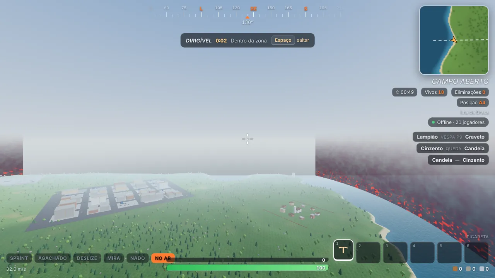
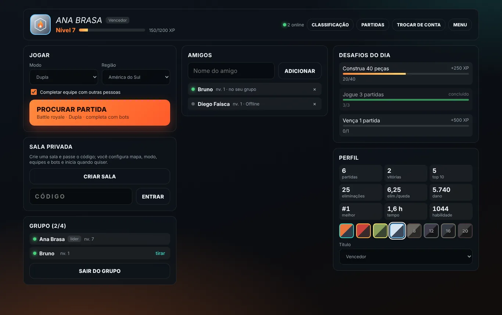
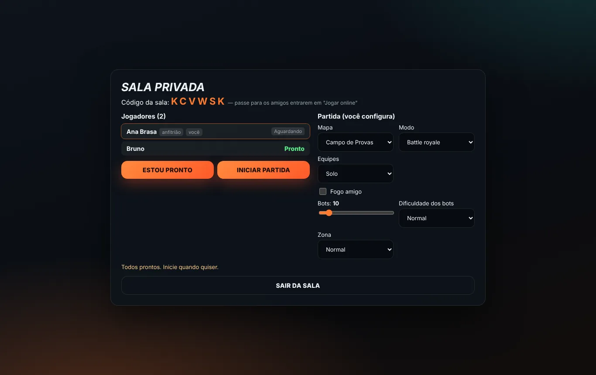
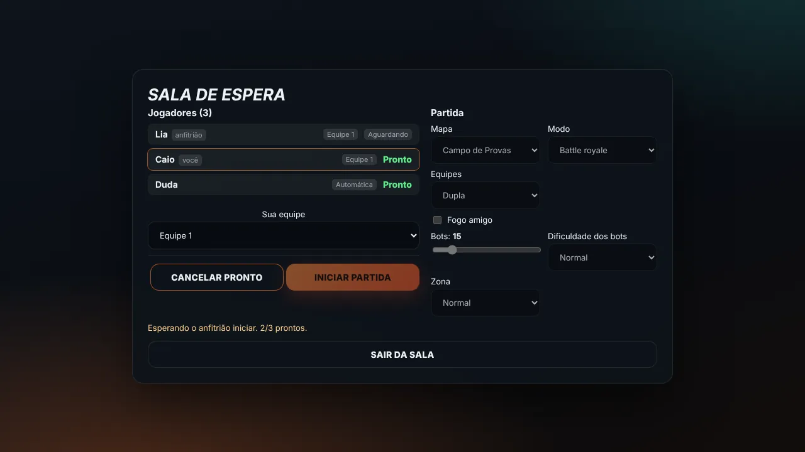
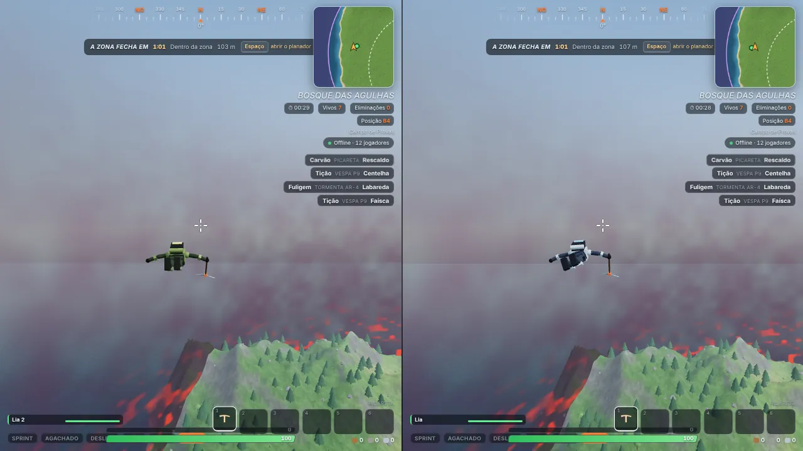
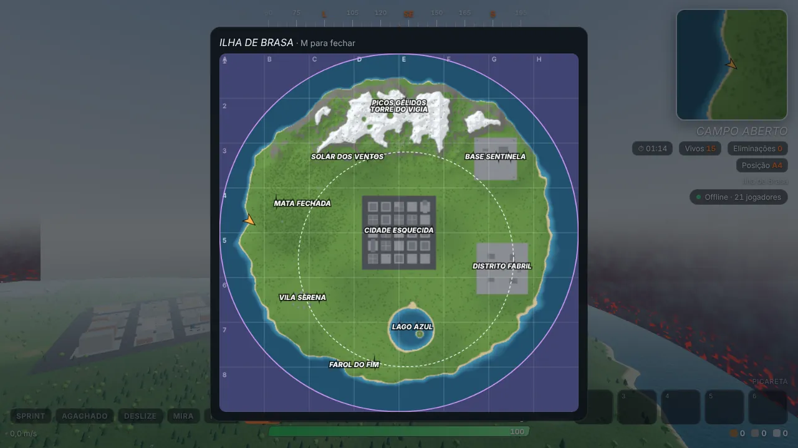
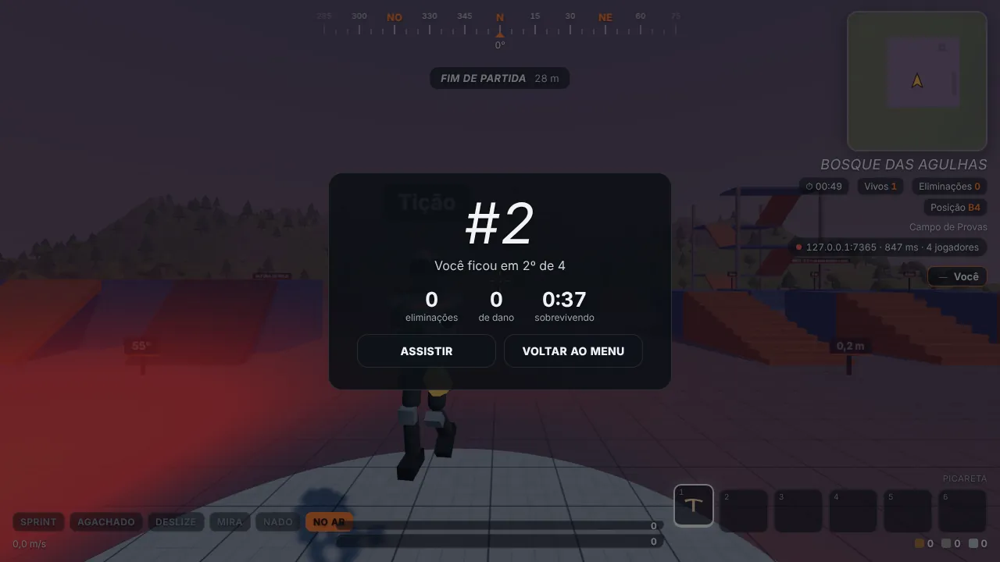
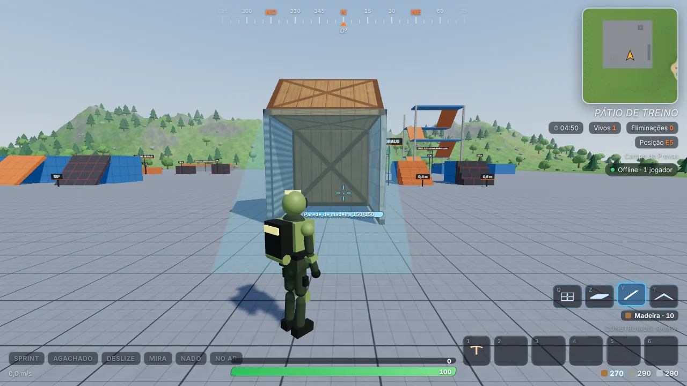
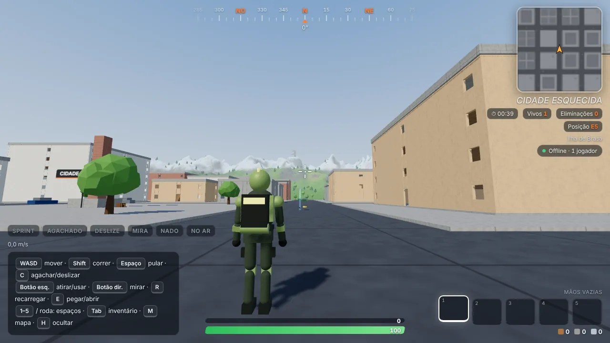
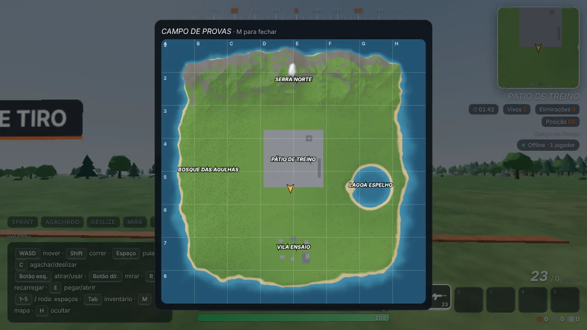

# Última Chama

Battle royale 3D em terceira pessoa, com partidas **offline**, em **rede local
(LAN)** e **online**, sobre um servidor autoritativo. Identidade, personagens,
armas, mapas e interface originais. *(Título provisório — definido em
`src/shared/config/game.ts`.)*

> **Estado: Fase 6 concluída — online.** Plataforma online (`npm run online`)
> com entrada **só pelo nome** (o nome é a conta), amigos com presença, grupos
> com convite, **matchmaking** de partidas públicas (solo, dupla, trio ou
> esquadrão, por região e habilidade, completando com bots), **salas privadas
> com código**, servidores de jogo alocados sob demanda com **bilhetes
> assinados**, resultados reportados pelo servidor de jogo, **XP, níveis,
> estatísticas, histórico, classificação, desafios do dia e visuais/títulos
> desbloqueáveis** guardados em banco (SQLite). A rede ficou ~10× mais leve:
> snapshots em delta por conexão e gerência de interesse. Próximo: polimento
> (arte, som e efeitos finais) — veja o [roteiro](docs/ROADMAP.md).
>
> **Fase 5 — multijogador local.** Sala de espera na rede local, descoberta
> automática das partidas, duplas/trios/esquadrões com fogo amigo opcional,
> reconexão ao mesmo personagem e tela dividida para 2 jogadores.
>
> **Fase 4 — primeira versão jogável de battle royale.**
> Partida completa offline contra até 99 bots (ou com amigos num servidor):
> aquecimento, salto do dirigível, queda livre e planador, saque, combate,
> construção, zona que fecha em 7 etapas e vencedor, com tela de resultado e
> histórico. Bots em três dificuldades navegam pelo mapa, saqueiam, lutam,
> se curam, constroem paredes e fogem da zona usando os mesmos comandos de um
> jogador. Somam-se à construção (Fase 3), às armas, inventário e loot
> (Fase 2) e ao mapa principal **Ilha de Brasa**. Próximo: lobby LAN e equipes
> — veja o [roteiro](docs/ROADMAP.md) e a [arquitetura](docs/ARQUITETURA.md).



| Plataforma online (grupo, amigos, desafios, perfil) | Sala privada com código |
| --- | --- |
|  |  |

| Sala de espera na rede local | Tela dividida (dupla no mesmo computador) |
| --- | --- |
|  |  |
| **Mapa com a zona e a próxima zona** | **Fim de partida** |
|  |  |
| **Construção** | **Picareta coletando pedra** |
|  |  |

| Ilha de Brasa — Cidade Esquecida | Arsenal do Campo de Provas |
| --- | --- |
|  |  |
| **Mapa (M)** | **Inventário (Tab)** |
|  |  |

*Capturas feitas em navegador sem GPU (renderização por software). Modelos,
texturas e sons são placeholders procedurais — veja "Limitações conhecidas".*

## Requisitos

- **Node.js 22.12+** e npm (para compilar e rodar o servidor).
- Navegador com **WebGL 2** (Chrome, Edge, Firefox ou Safari atuais) e, de
  preferência, placa de vídeo dedicada ou integrada recente.

## Instalação

```bash
cd game
npm install
```

## Como jogar

### Offline (sem internet)

```bash
npm run host
```

Abra `http://localhost:7350`, clique em **Jogar offline**, escolha o modo —
**Battle royale** (você contra 0–99 bots, zona normal ou rápida, bots fáceis,
normais ou difíceis) ou **Treino** (sem zona, com renascimento) — e o mapa:

- **Ilha de Brasa** — mapa principal (1,6 km): cidade, floresta, montanhas,
  distrito industrial, vilarejo, lago, base militar, farol, mansão e torre.
- **Campo de Provas** — treino: arsenal com todas as armas e mesas de madeira,
  pedra e metal (repõem a cada 8 s), estande de tiro com bonecos a
  10/25/50/75 m, pista de movimentação e pátio alinhado à grade de construção.

O servidor da partida roda dentro do próprio navegador (Web Worker); depois de
aberta, a página não precisa de rede.

Para desenvolvimento com recarga automática: `npm run dev` e abra
`http://localhost:5173`.

### Rede local (LAN)

No computador anfitrião:

```bash
npm run host
```

O terminal mostra os endereços, por exemplo:

```
  Neste computador:  http://localhost:7350
  Na rede local:     http://192.168.0.10:7350
```

Nos outros computadores da mesma rede, abra o endereço "Na rede local" e
clique em **Rede local**: a lista **Partidas na rede local** mostra
este e os outros servidores encontrados (cada um se anuncia por UDP na porta
7351); clique em **Entrar**. Todos caem na **sala de espera**: cada um marca
"pronto" e escolhe a equipe; o primeiro a entrar é o anfitrião, configura a
partida (mapa, battle royale ou treino, bots e dificuldade, solo/duplas/trios/
esquadrões, fogo amigo, zona) e clica em **Iniciar partida**. No fim, todos
voltam à sala. Se a rede de alguém cair, o personagem espera 60 s no mundo e o
jogo reconecta sozinho ao mesmo personagem. Se o firewall perguntar, permita o
Node na rede privada (TCP 7350 e UDP 7351).

Sem sala de espera (partida contínua, entra quem chegar):
`npm run server -- --mode br --bots 20` ou `--mode treino`.

### Tela dividida

Em **Jogar offline**, escolha **Neste computador: 2 jogadores (tela dividida)**:
o jogador 1 usa teclado e mouse e o jogador 2 o primeiro controle conectado
(padrão Xbox/PlayStation). Com equipes, os dois ficam na mesma.

### Online (plataforma)

Num servidor acessível pela internet (ou no seu computador, para testar):

```bash
npm run online
```

O terminal mostra o endereço (porta **7370**). Cada pessoa abre esse endereço
no navegador e clica em **Jogar online**:

1. **Entrar**: digite só o seu nome — sem senha, o nome é a conta. Entrando
   com o mesmo nome em outro computador, você continua com o mesmo nível,
   amigos e estatísticas (a sessão fica salva no navegador; ao recarregar a
   página você entra direto).
2. **Amigos**: adicione pelo nome; o outro aceita. A lista mostra quem está
   no menu, procurando partida, em partida ou em sala privada.
3. **Grupo**: clique em **convidar** num amigo online; ele aceita no topo da
   tela. O líder escolhe o modo (Solo, Dupla, Trio, Esquadrão), a região e
   **Procurar partida**: o grupo inteiro cai na mesma partida, na mesma equipe.
4. **Partida pública**: o matchmaking junta grupos de habilidade parecida
   (a janela alarga com a espera) e, depois de ~20 s, começa com quem houver
   e completa com bots. Ao terminar, XP, estatísticas e desafios já aparecem
   na tela; o servidor da partida é encerrado e todos voltam à plataforma.
5. **Sala privada**: **Criar sala** gera um código de 6 letras/números; os
   amigos digitam o código e **Entrar**. É a mesma sala de espera da LAN (o
   dono escolhe mapa, modo, equipes, bots e inicia), com partidas seguidas.
6. **Perfil**: nível e XP, estatísticas (partidas, vitórias, top 10,
   eliminações, dano, tempo, habilidade), visuais liberados por nível,
   título, histórico de partidas e classificação geral.

Opções: `npm run platform -- --help` (porta, arquivo do banco, segredo dos
bilhetes, mapa, servidores simultâneos, tamanho do lobby, espera da fila,
aquecimento, zona, dificuldade dos bots, `--trust-proxy`). Em produção,
coloque-a atrás de um proxy com TLS (`wss://`) e defina `PLATFORM_SECRET`
(segredo dos bilhetes). O banco fica em `data/plataforma.db`.

### Servidor dedicado sem plataforma

O servidor da LAN também roda sozinho numa máquina na nuvem, com entrada pelo
endereço (sem contas): `npm run server -- --port 7350 --max-players 32`.

Opções do servidor: `npm run server -- --help` (sala de espera, modo, bots e
dificuldade, equipes e fogo amigo, aquecimento, velocidade da zona, reinício
automático, espera de reconexão, descoberta na rede). Em battle royale, a
contagem do aquecimento começa quando a primeira pessoa entra; quem chega com a
partida em andamento assiste até a próxima, e no fim todos reconectam sozinhos
para a partida seguinte.

## Controles

| Ação | Teclado e mouse | Controle |
| --- | --- | --- |
| Mover | W A S D | analógico esquerdo |
| Olhar | mouse | analógico direito |
| Atirar / usar item / golpear / construir | botão esquerdo | RT |
| Mirar | botão direito | LT |
| Recarregar | R | Y |
| Pegar item / abrir baú | E | X |
| Picareta | 1 | LB / RB |
| Escolher espaço | 2–6, roda do mouse | LB / RB |
| Construir parede · piso · rampa · telhado | Q · Z · V · T (a mesma tecla sai) | direcional ↑ (alterna) |
| Girar a peça (no modo construção) | R | direcional ← |
| Trocar material | G (ou botão direito no modo construção) | direcional → |
| Inventário | Tab | View/Back |
| Mapa | M | — |
| Correr (sprint) | Shift | L3 |
| Caminhar devagar | Alt ou X | — |
| Pular / saltar do dirigível / abrir o planador | Espaço | A |
| Agachar / deslizar (correndo) | C | B |
| Pausa / liberar o mouse | Esc | Start |
| Painel técnico | F3 | — |
| Mostrar/ocultar ajuda | H | — |

O agachar usa **C** (e não Ctrl) porque Ctrl+W fecha a aba no navegador. No
modo construção a roda do mouse troca a peça e qualquer tecla de espaço (1–6)
volta às armas.

## O que há no jogo (Fases 2, 3 e 4)

| Sistema | Detalhes |
| --- | --- |
| Partida | aquecimento (sem dano) → dirigível → queda livre e planador → combate → vencedor; colocação final, espectador de quem eliminou você (clique troca), tela de resultado e "Jogar de novo" |
| Zona | 7 etapas (~9 min, ou ~4 min na rápida), centro sempre em terra, dano de 1 a 25 por segundo direto na vida; parede animada, contorno no minimapa e no mapa, próxima zona tracejada, aviso fora dela |
| Bots | 0–99, Fácil/Normal/Difícil; navegam (A* com portas), saqueiam itens e baús, escolhem arma pela distância, miram com reação e erro, constroem paredes, se curam, fogem, coletam materiais e respeitam a zona |
| Histórico | partidas salvas no navegador com colocação, eliminações, dano e tempo; totais (vitórias, top 5, melhor colocação) |
| Armas | Vespa P9 (pistola), Enxame M7 (submetralhadora), Tormenta AR-4 (fuzil), Trovão 12 (escopeta, 9 bagos), Falcão de Ferrolho (sniper com luneta), Rojão RL (lança-foguetes) — dano, cadência, dispersão, coice, pente, recarga, alcance e queda de dano por distância |
| Raridade | Comum, Incomum, Raro, Épico, Lendário (mais dano e recarga mais rápida) |
| Explosivos | foguete (explode no impacto) e granada (quica, pavio de 2,4 s), dano em área com linha de visão |
| Cura e escudo | Bandagem (até 75), Kit Médico (até 100), Célula de Escudo (até 50), Bateria de Escudo (até 100) |
| Inventário | 5 espaços, empilhamento, troca quando cheio, soltar e reorganizar; munição por tipo; madeira, pedra e metal |
| Loot | 250+ pontos no mapa principal e 100 baús; raridade maior em baús e áreas de risco |
| Combate | servidor decide acertos com compensação de latência (até 1 s); escudo absorve primeiro; cabeça vale mais; dano de queda |
| Eliminação | o corpo solta tudo; feed de eliminações; tela de eliminado e espectador do autor; renascimento em 5 s (modo treino) |
| HUD | vida, escudo, munição, espaços, recursos, minimapa, tempo, vivos, eliminações, posição na grade, bússola, mira dinâmica, marcador de acerto, indicador de dano, números de dano |
| Construção | parede, piso, rampa (45°) e telhado numa grade de 4 m; madeira (150 de vida, 3 s), pedra (300, 6 s) e metal (450, 9 s); custo 10; fantasma azul/vermelho com o motivo do bloqueio; prevista no cliente e confirmada pelo servidor |
| Integridade | só se constrói apoiado no chão ou em outra peça; o que perde a ligação com o chão desaba |
| Destruição | balas, picareta (50) e explosões (×3) derrubam peças; vida da peça sob a mira no HUD |
| Picareta | sempre disponível; 20 de dano em jogadores; coleta madeira, pedra e metal (árvores, rochas, caixotes, carros, contêineres, prédios); árvores, rochas e caixotes quebram |
| Áudio | sons sintetizados e posicionais (tiros, explosões, recarga, coleta, baús, acertos, construção, golpes, quebra e desabamento) |

## Scripts

| Comando | O que faz |
| --- | --- |
| `npm run dev` | cliente em modo desenvolvimento (Vite, :5173; repassa `/ws` ao servidor em :7350 e `/platform`/`/game` à plataforma em :7370) |
| `npm run server` | servidor dedicado/LAN (serve `dist/client` se existir) |
| `npm run host` | compila o cliente e sobe o servidor servindo o jogo (sala de espera de LAN) |
| `npm run online` | compila o cliente e sobe a plataforma online (:7370) |
| `npm run platform` | só a plataforma (usa o `dist/client` existente) |
| `npm run build` | verificação de tipos + build do cliente em `dist/client` |
| `npm test` | testes unitários e de integração (Vitest) |
| `npm run test:e2e` | testes no navegador (Playwright) |
| `npm run check` | tipos + testes unitários |
| `npx tsx scripts/bench-net.ts` | banda por cliente numa partida de bots |
| `npx tsx scripts/load-test.ts 100 120` | teste de carga: 100 pessoas simuladas pela plataforma |

Para os testes de navegador em uma máquina nova: `npx playwright install chromium`.

## Testes

- **Unitários e integração (163)**: plataforma online (entrada pelo nome,
  sessão, conta aberta em outro lugar, amizade, presença, grupo e permissões
  do líder, fila de dupla → servidor alocado → bilhetes → partida até o fim →
  XP, estatísticas, histórico e desafios; fila sozinho com bots; sala privada
  pelo código; visuais e títulos bloqueados; mensagens inválidas e inundação;
  WebSocket real até o servidor de jogo); bilhetes assinados (servidor errado,
  vencido, adulterado); matchmaking (habilidade, espera, grupos, regiões);
  banco (contas, sessões, amizades, resultado gravado uma vez, desafios);
  progressão; servidor online (bilhete obrigatório, nome/visual/grupo do
  bilhete, conta em dois lugares, aquecimento encurtado, colocação de cada
  pessoa inclusive de quem desistiu); snapshots em delta e gerência de
  interesse; equipes (montagem, fogo amigo, colocação e
  vitória por equipe, partida de esquadrões só de bots); sala de espera
  (prontos, permissões do anfitrião, início, volta à sala); reconexão ao mesmo
  personagem e expiração; descoberta UDP entre dois servidores; dirigível, queda livre e planador; zona
  (círculos aninhados em terra, tempos), fases, colocação e vencedor; servidor
  em modo battle royale (espectador atrasado, reinício e reconexão); uma partida
  inteira só de bots no mapa principal (24 bots, com vencedor e a maior parte das
  eliminações em combate); colisão, movimentação, mapas (geração
  determinística, todos os pontos de surgimento seguros, subida da escada de
  um prédio de 4 andares até a laje), catálogo de itens, armas (cadência,
  recarga, dispersão determinística), consumíveis, inventário, caixas de
  acerto, projéteis, protocolo, servidor (acertos com compensação de latência,
  cobertura bloqueando tiros, eliminação com loot do corpo e renascimento,
  baús, foguetes e granadas, bonecos de treino, anti-speed hack), construção
  (geometria, alvo, apoio, desabamento, corrida de rampas, construção
  autoritativa, custo e intervalo, paredes bloqueando tiros, explosões,
  picareta, coleta, sincronização), predição sem correções com 100 ms de
  latência (inclusive construindo) e servidor WebSocket real.
- **Navegador (12)**: **plataforma online com dois navegadores** (nome curto
  recusado, entrada pelo nome, amizade e presença, convite para o grupo, dupla
  pelo matchmaking na mesma equipe, partida até o fim com XP e estatísticas,
  sala privada pelo código, sair pela pausa de volta à plataforma, volta pela
  sessão salva); sala de espera com dois navegadores (dupla na mesma
  equipe, início pelo anfitrião, queda da conexão e volta ao mesmo
  personagem); tela dividida com controle simulado; battle royale offline (aquecimento, dirigível, salto,
  planador, pouso, zona e bots) e uma partida até o fim num servidor dedicado
  (resultado, histórico e reconexão para a partida seguinte); menu e configurações; partida offline (movimento, pulo,
  deslize, mira, pausa); arsenal → acerto no boneco → inventário → soltar;
  **construção offline** (pegar madeira, erguer parede e rampa, subir,
  derrubar com a picareta, coletar pedra); dois jogadores se vendo no servidor
  dedicado; **combate entre dois navegadores**; **construção entre dois
  navegadores** (A ergue uma parede, B a vê; A a derruba e ela some para B).

## Estrutura

```
src/shared   simulação determinística compartilhada (movimento, combate, itens, mapas, protocolo)
src/server   Simulation/GameHost (autoridade, loot, dano) e o servidor Node (HTTP + WebSocket)
src/platform plataforma online: banco, contas, amigos, grupos, matchmaking, salas, servidores de jogo
src/client   renderização (three.js), personagem, armas, efeitos, áudio, câmera, entrada, rede, HUD
tests        unit (Vitest) e e2e (Playwright)
docs         ARQUITETURA.md, ROADMAP.md, imagens/
```

Detalhes em [docs/ARQUITETURA.md](docs/ARQUITETURA.md).

## Configuração e dependências

| Dependência | Uso |
| --- | --- |
| `three` | renderização 3D (WebGL 2) |
| `ws` | WebSocket no servidor |
| `node:sqlite` (embutido no Node 22) | banco da plataforma online — nenhuma instalação extra |
| `tsx` | executa o servidor TypeScript |
| `vite` (dev) | build do cliente |
| `vitest`, `@playwright/test` (dev) | testes |
| `typescript`, `@types/*` (dev) | tipos |

Variáveis de ambiente do servidor: `PORT` e `HOST` (equivalem a `--port` e
`--host`). Da plataforma: `PORT`, `HOST`, `PLATFORM_DB` (arquivo do banco) e
`PLATFORM_SECRET` (segredo dos bilhetes de entrada). Configurações do jogador ficam no navegador (`localStorage`),
inclusive o volume.

## Limitações conhecidas (Fase 6)

- **Conta só pelo nome, sem senha** (decisão do projeto): quem souber o nome
  de alguém entra na conta dessa pessoa. Para uso público, o próximo passo é
  um código pessoal ou login por e-mail (a sessão já é um token separado do
  nome).
- A plataforma roda os servidores de jogo no mesmo processo (até
  `--max-servers` partidas simultâneas). O bilhete assinado já permite
  servidores em outras máquinas com o mesmo segredo; o registro automático de
  nós e a imagem de container ficam para a Fase 8.
- Regiões são rótulos da fila (separam quem joga junto); com um único
  processo, todas as partidas rodam na mesma máquina.
- O transporte é WebSocket (TCP). WebTransport/datagramas e detecção
  estatística de mira automática ficam para as Fases 7–8. O teste de carga
  usa 100 clientes simulados na mesma máquina, não 100 computadores.

- Em equipes não há "derrubado e reanimar": quem perde a vida é eliminado e
  assiste os colegas.
- A tela dividida é offline e para 2 jogadores; ela desenha o mundo duas
  vezes (precisa de uma placa de vídeo razoável no mapa principal).
- Bots ficam no térreo dos prédios (não sobem escadas) e constroem só paredes
  defensivas; não usam granadas.
- Offline e na LAN, o histórico fica no navegador (só as partidas online
  contam XP e estatísticas da conta).
- Ainda não há edição de peças (abrir portas e janelas em paredes).
- A grade de construção é absoluta: em encostas, peças podem ficar
  parcialmente enterradas (como em outros jogos do gênero).
- Assets (modelos, texturas, animações e sons) são placeholders procedurais;
  a troca por arte final está prevista na Fase 7 e os pontos de troca estão
  documentados na arquitetura.
- O coice da arma é aplicado no cliente (como na maioria dos jogos); o servidor
  valida dispersão, cadência, munição e acertos.
- Banda medida: ~3,4 KB/s por cliente numa partida espalhada (60 bots +
  8 clientes; antes da Fase 6: 35 KB/s) e ~15 KB/s por pessoa no pior caso
  (100 pessoas agrupadas, `scripts/load-test.ts`; servidor a 4,5 ms por tick).
  Ainda não há taxa adaptativa para conexões lentas.
- A descoberta de partidas na LAN funciona pela página servida por um host
  (o navegador não escuta UDP); quem abre o jogo de outro lugar entra pelo
  endereço exibido no terminal do host.
