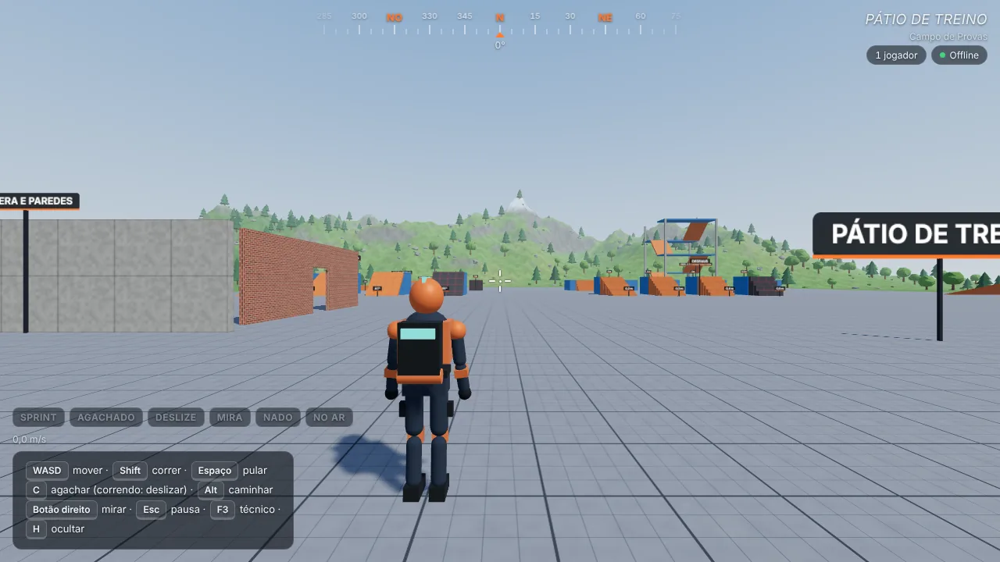
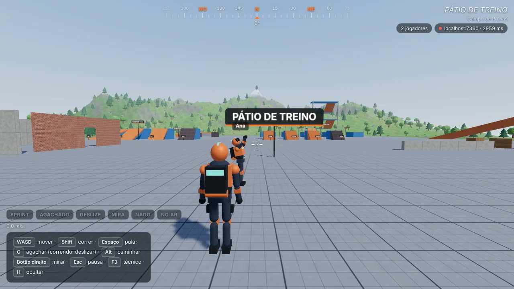
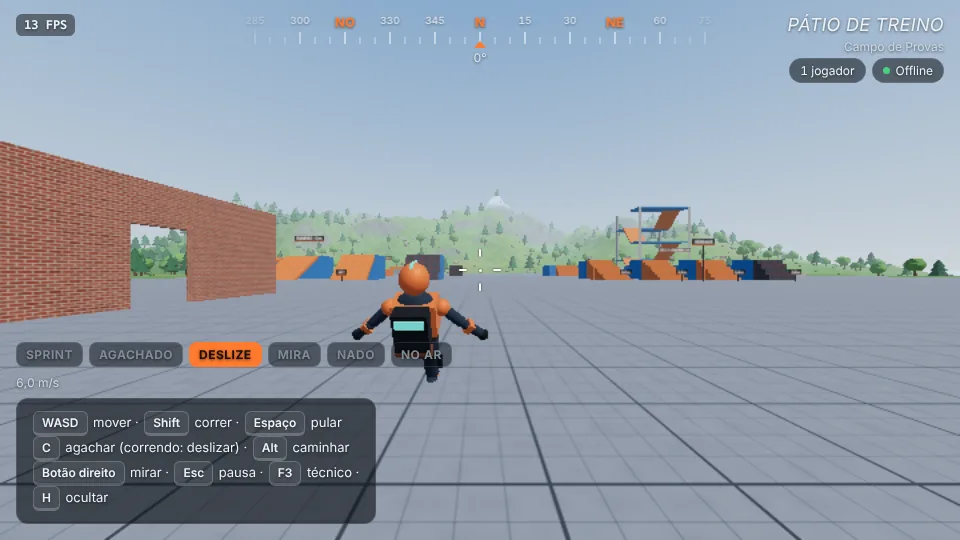

# Última Chama

Battle royale 3D em terceira pessoa, com partidas **offline**, em **rede local
(LAN)** e **online**, sobre um servidor autoritativo. Identidade, personagens,
mapa e interface originais. *(Título provisório — definido em
`src/shared/config/game.ts`.)*

> **Estado: Fase 1 concluída (Fundação).** Já dá para jogar: movimentação
> completa no mapa de testes, sozinho (offline) ou com outras pessoas no mesmo
> servidor. Armas, construção, bots e zona chegam nas próximas fases — veja o
> [roteiro](docs/ROADMAP.md) e a [arquitetura](docs/ARQUITETURA.md).



| Multijogador (dois navegadores no mesmo servidor) | Deslize |
| --- | --- |
|  |  |

*Capturas feitas em navegador sem GPU (renderização por software). Os assets
são placeholders procedurais — veja "Limitações conhecidas".*

## Requisitos

- **Node.js 22.12+** e npm (para compilar e rodar o servidor).
- Navegador com **WebGL 2** (Chrome, Edge, Firefox ou Safari atuais) e, de
  preferência, placa de vídeo dedicada ou integrada recente.

## Instalação

```bash
cd game
npm install
```

## Como jogar

### Offline (sem internet)

```bash
npm run host
```

Abra `http://localhost:7350` e clique em **Jogar offline**. O servidor da
partida roda dentro do próprio navegador (Web Worker); depois de aberta, a
página não precisa de rede.

Para desenvolvimento com recarga automática: `npm run dev` e abra
`http://localhost:5173`.

### Rede local (LAN)

No computador anfitrião:

```bash
npm run host
```

O terminal mostra os endereços, por exemplo:

```
  Neste computador:  http://localhost:7350
  Na rede local:     http://192.168.0.10:7350
```

Nos outros computadores da mesma rede, abra o endereço "Na rede local" no
navegador, clique em **Entrar em servidor** e em **Conectar** (com o campo de
endereço vazio, conecta ao próprio host). Se o firewall perguntar, permita o
Node na rede privada (porta TCP 7350).

### Online (servidor dedicado)

O mesmo servidor roda em uma máquina na nuvem:

```bash
npm run build
npm run server -- --port 7350 --max-players 32 --name "Servidor BR-1"
```

Em produção, coloque-o atrás de um proxy com TLS (o cliente conecta por
`wss://seu-dominio/ws`). Matchmaking, contas e convites chegam na Fase 6.

Opções do servidor: `npm run server -- --help`.

## Controles

| Ação | Teclado e mouse | Controle |
| --- | --- | --- |
| Mover | W A S D | analógico esquerdo |
| Olhar | mouse | analógico direito |
| Correr (sprint) | Shift | L3 |
| Caminhar devagar | Alt ou X | — |
| Pular | Espaço | A |
| Agachar / deslizar (correndo) | C | B |
| Mirar | botão direito | LT |
| Pausa / liberar o mouse | Esc | Start |
| Painel técnico | F3 | — |
| Mostrar/ocultar ajuda | H | — |

O agachar usa **C** (e não Ctrl) porque Ctrl+W fecha a aba no navegador.

## Scripts

| Comando | O que faz |
| --- | --- |
| `npm run dev` | cliente em modo desenvolvimento (Vite, :5173; repassa `/ws` ao servidor em :7350) |
| `npm run server` | servidor dedicado/LAN (serve `dist/client` se existir) |
| `npm run host` | compila o cliente e sobe o servidor servindo o jogo |
| `npm run build` | verificação de tipos + build do cliente em `dist/client` |
| `npm test` | testes unitários e de integração (Vitest) |
| `npm run test:e2e` | testes no navegador (Playwright): offline e dois jogadores |
| `npm run check` | tipos + testes unitários |

Para os testes de navegador em uma máquina nova: `npx playwright install chromium`.

## Testes

- **Unitários e integração (58)**: colisão, movimentação (rampas, degraus,
  túnel, deslize, nado, queda de 150 m sem atravessar o piso, determinismo bit a
  bit), geração do mapa, protocolo, servidor (handshake, expulsões, anti-speed
  hack, inundação), predição contra o servidor real com 100 ms de latência
  (zero correções) e servidor WebSocket real com dois clientes.
- **Navegador (3)**: menu e configurações; partida offline completa (olhar,
  andar, pular, sprint, deslize, mira, pausa); dois navegadores no mesmo
  servidor se vendo, com nomes, movimento e saída.

## Estrutura

```
src/shared   simulação determinística compartilhada (movimento, colisão, mapas, protocolo)
src/server   GameHost/Simulation (autoridade) e o servidor Node (HTTP + WebSocket)
src/client   renderização (three.js), personagem, câmera, entrada, rede, interface
tests        unit (Vitest) e e2e (Playwright)
docs         ARQUITETURA.md, ROADMAP.md
```

Detalhes em [docs/ARQUITETURA.md](docs/ARQUITETURA.md).

## Configuração e dependências

| Dependência | Uso |
| --- | --- |
| `three` | renderização 3D (WebGL 2) |
| `ws` | WebSocket no servidor |
| `tsx` | executa o servidor TypeScript |
| `vite` (dev) | build do cliente |
| `vitest`, `@playwright/test` (dev) | testes |
| `typescript`, `@types/*` (dev) | tipos |

Variáveis de ambiente do servidor: `PORT` e `HOST` (equivalem a `--port` e
`--host`). Configurações do jogador ficam no navegador (`localStorage`).

## Limitações conhecidas (Fase 1)

- Assets são placeholders procedurais (modelos, texturas, animações) — a troca
  por arte final está prevista na Fase 7 e os pontos de troca estão documentados.
- Sem sons ainda (Fase 7).
- Snapshots enviam todos os jogadores a todos: ótimo até dezenas de jogadores;
  para 100, a gerência de interesse e a compressão delta entram na Fase 6.
- A descoberta automática de partidas na LAN vem com o app desktop (Fases 5/8);
  hoje entra-se pelo endereço exibido no host.
