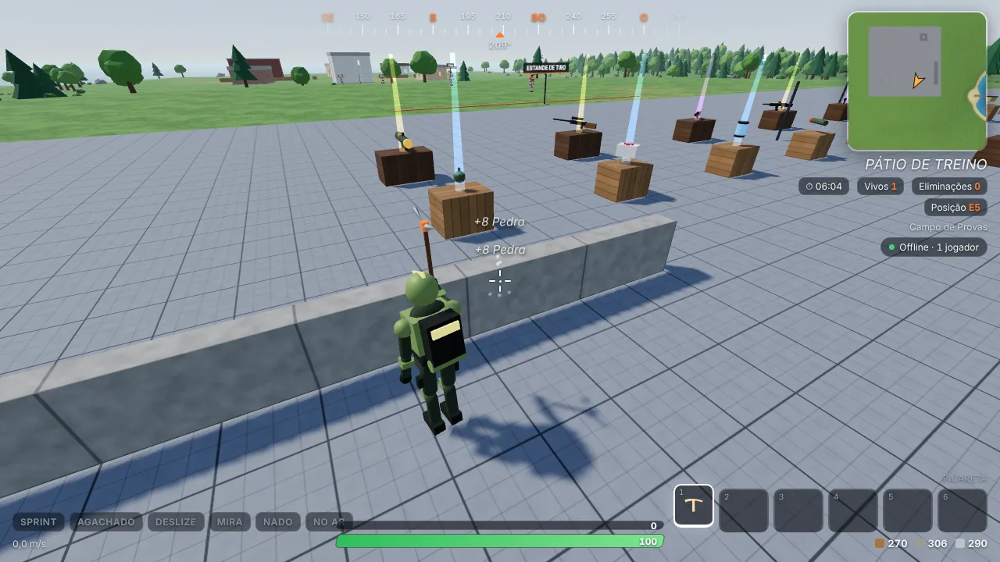
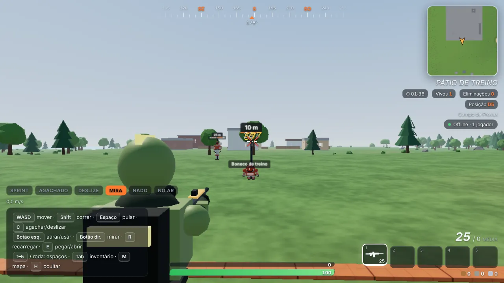
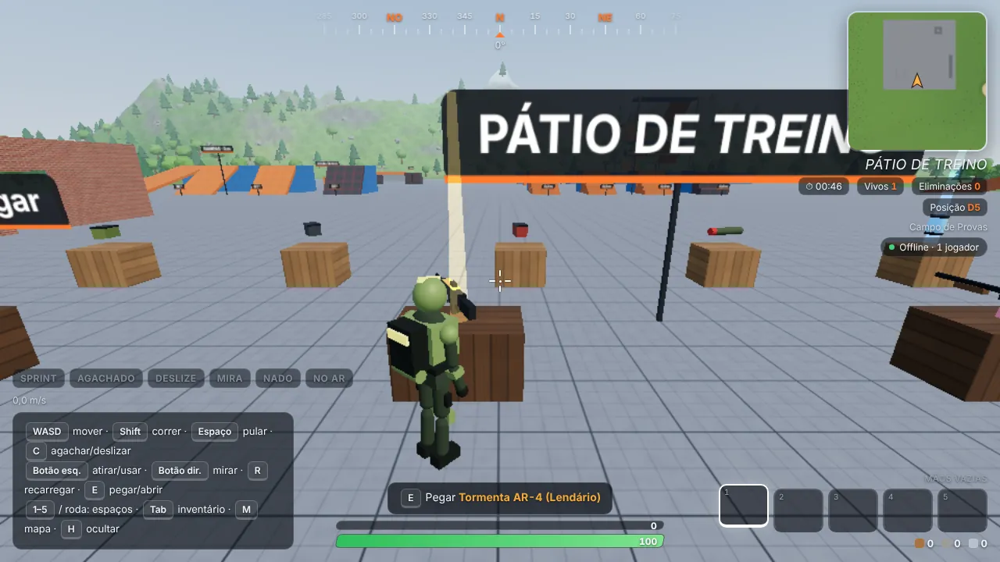
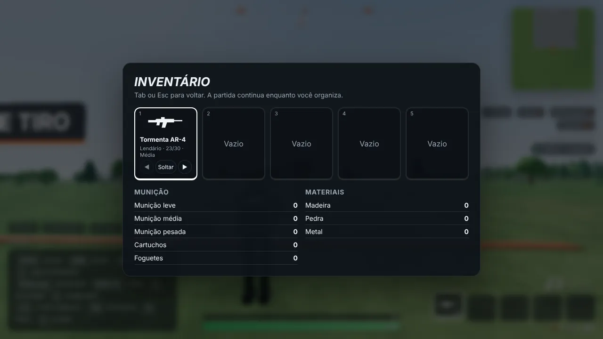

# Última Chama

Battle royale 3D em terceira pessoa, com partidas **offline**, em **rede local
(LAN)** e **online**, sobre um servidor autoritativo. Identidade, personagens,
armas, mapas e interface originais. *(Título provisório — definido em
`src/shared/config/game.ts`.)*

> **Estado: Fase 3 concluída (Construção).** Paredes, pisos, rampas e
> telhados de madeira, pedra e metal, com fantasma de pré-visualização,
> construção prevista no cliente e validada pelo servidor, vida que cresce
> durante a obra, destruição e desabamento do que fica sem apoio; picareta
> para coletar materiais e quebrar árvores, rochas e caixotes. Somam-se às armas
> com raridade, tiro com compensação de latência, vida e escudo, inventário,
> loot, explosivos e ao mapa principal **Ilha de Brasa** — offline ou com outras
> pessoas no mesmo servidor, em modo treino (quem é eliminado renasce). Bots,
> zona segura e a partida completa de battle royale vêm na Fase 4 — veja o
> [roteiro](docs/ROADMAP.md) e a [arquitetura](docs/ARQUITETURA.md).


| Picareta coletando pedra | Estande de tiro |
| --- | --- |
|  |  |

| Ilha de Brasa — Cidade Esquecida | Arsenal do Campo de Provas |
| --- | --- |
|  |  |
| **Mapa (M)** | **Inventário (Tab)** |
|  |  |

*Capturas feitas em navegador sem GPU (renderização por software). Modelos,
texturas e sons são placeholders procedurais — veja "Limitações conhecidas".*

## Requisitos

- **Node.js 22.12+** e npm (para compilar e rodar o servidor).
- Navegador com **WebGL 2** (Chrome, Edge, Firefox ou Safari atuais) e, de
  preferência, placa de vídeo dedicada ou integrada recente.

## Instalação

```bash
cd game
npm install
```

## Como jogar

### Offline (sem internet)

```bash
npm run host
```

Abra `http://localhost:7350`, clique em **Jogar offline** e escolha o mapa:

- **Ilha de Brasa** — mapa principal (1,6 km): cidade, floresta, montanhas,
  distrito industrial, vilarejo, lago, base militar, farol, mansão e torre.
- **Campo de Provas** — treino: arsenal com todas as armas e mesas de madeira,
  pedra e metal (repõem a cada 8 s), estande de tiro com bonecos a
  10/25/50/75 m, pista de movimentação e pátio alinhado à grade de construção.

O servidor da partida roda dentro do próprio navegador (Web Worker); depois de
aberta, a página não precisa de rede.

Para desenvolvimento com recarga automática: `npm run dev` e abra
`http://localhost:5173`.

### Rede local (LAN)

No computador anfitrião:

```bash
npm run host                               # Ilha de Brasa
npm run host -- --map campo-de-provas      # ou o mapa de treino
```

O terminal mostra os endereços, por exemplo:

```
  Neste computador:  http://localhost:7350
  Na rede local:     http://192.168.0.10:7350
```

Nos outros computadores da mesma rede, abra o endereço "Na rede local" no
navegador, clique em **Entrar em servidor** e em **Conectar** (com o campo de
endereço vazio, conecta ao próprio host). Se o firewall perguntar, permita o
Node na rede privada (porta TCP 7350).

### Online (servidor dedicado)

O mesmo servidor roda em uma máquina na nuvem:

```bash
npm run build
npm run server -- --port 7350 --max-players 32 --name "Servidor BR-1"
```

Em produção, coloque-o atrás de um proxy com TLS (o cliente conecta por
`wss://seu-dominio/ws`). Matchmaking, contas e convites chegam na Fase 6.

Opções do servidor: `npm run server -- --help`.

## Controles

| Ação | Teclado e mouse | Controle |
| --- | --- | --- |
| Mover | W A S D | analógico esquerdo |
| Olhar | mouse | analógico direito |
| Atirar / usar item / golpear / construir | botão esquerdo | RT |
| Mirar | botão direito | LT |
| Recarregar | R | Y |
| Pegar item / abrir baú | E | X |
| Picareta | 1 | LB / RB |
| Escolher espaço | 2–6, roda do mouse | LB / RB |
| Construir parede · piso · rampa · telhado | Q · Z · V · T (a mesma tecla sai) | direcional ↑ (alterna) |
| Girar a peça (no modo construção) | R | direcional ← |
| Trocar material | G (ou botão direito no modo construção) | direcional → |
| Inventário | Tab | View/Back |
| Mapa | M | — |
| Correr (sprint) | Shift | L3 |
| Caminhar devagar | Alt ou X | — |
| Pular | Espaço | A |
| Agachar / deslizar (correndo) | C | B |
| Pausa / liberar o mouse | Esc | Start |
| Painel técnico | F3 | — |
| Mostrar/ocultar ajuda | H | — |

O agachar usa **C** (e não Ctrl) porque Ctrl+W fecha a aba no navegador. No
modo construção a roda do mouse troca a peça e qualquer tecla de espaço (1–6)
volta às armas.

## O que há no jogo (Fases 2 e 3)

| Sistema | Detalhes |
| --- | --- |
| Armas | Vespa P9 (pistola), Enxame M7 (submetralhadora), Tormenta AR-4 (fuzil), Trovão 12 (escopeta, 9 bagos), Falcão de Ferrolho (sniper com luneta), Rojão RL (lança-foguetes) — dano, cadência, dispersão, coice, pente, recarga, alcance e queda de dano por distância |
| Raridade | Comum, Incomum, Raro, Épico, Lendário (mais dano e recarga mais rápida) |
| Explosivos | foguete (explode no impacto) e granada (quica, pavio de 2,4 s), dano em área com linha de visão |
| Cura e escudo | Bandagem (até 75), Kit Médico (até 100), Célula de Escudo (até 50), Bateria de Escudo (até 100) |
| Inventário | 5 espaços, empilhamento, troca quando cheio, soltar e reorganizar; munição por tipo; madeira, pedra e metal |
| Loot | 250+ pontos no mapa principal e 100 baús; raridade maior em baús e áreas de risco |
| Combate | servidor decide acertos com compensação de latência (até 1 s); escudo absorve primeiro; cabeça vale mais; dano de queda |
| Eliminação | o corpo solta tudo; feed de eliminações; tela de eliminado e espectador do autor; renascimento em 5 s (modo treino) |
| HUD | vida, escudo, munição, espaços, recursos, minimapa, tempo, vivos, eliminações, posição na grade, bússola, mira dinâmica, marcador de acerto, indicador de dano, números de dano |
| Construção | parede, piso, rampa (45°) e telhado numa grade de 4 m; madeira (150 de vida, 3 s), pedra (300, 6 s) e metal (450, 9 s); custo 10; fantasma azul/vermelho com o motivo do bloqueio; prevista no cliente e confirmada pelo servidor |
| Integridade | só se constrói apoiado no chão ou em outra peça; o que perde a ligação com o chão desaba |
| Destruição | balas, picareta (50) e explosões (×3) derrubam peças; vida da peça sob a mira no HUD |
| Picareta | sempre disponível; 20 de dano em jogadores; coleta madeira, pedra e metal (árvores, rochas, caixotes, carros, contêineres, prédios); árvores, rochas e caixotes quebram |
| Áudio | sons sintetizados e posicionais (tiros, explosões, recarga, coleta, baús, acertos, construção, golpes, quebra e desabamento) |

## Scripts

| Comando | O que faz |
| --- | --- |
| `npm run dev` | cliente em modo desenvolvimento (Vite, :5173; repassa `/ws` ao servidor em :7350) |
| `npm run server` | servidor dedicado/LAN (serve `dist/client` se existir) |
| `npm run host` | compila o cliente e sobe o servidor servindo o jogo |
| `npm run build` | verificação de tipos + build do cliente em `dist/client` |
| `npm test` | testes unitários e de integração (Vitest) |
| `npm run test:e2e` | testes no navegador (Playwright) |
| `npm run check` | tipos + testes unitários |

Para os testes de navegador em uma máquina nova: `npx playwright install chromium`.

## Testes

- **Unitários e integração (116)**: colisão, movimentação, mapas (geração
  determinística, todos os pontos de surgimento seguros, subida da escada de
  um prédio de 4 andares até a laje), catálogo de itens, armas (cadência,
  recarga, dispersão determinística), consumíveis, inventário, caixas de
  acerto, projéteis, protocolo, servidor (acertos com compensação de latência,
  cobertura bloqueando tiros, eliminação com loot do corpo e renascimento,
  baús, foguetes e granadas, bonecos de treino, anti-speed hack), construção
  (geometria, alvo, apoio, desabamento, corrida de rampas, construção
  autoritativa, custo e intervalo, paredes bloqueando tiros, explosões,
  picareta, coleta, sincronização), predição sem correções com 100 ms de
  latência (inclusive construindo) e servidor WebSocket real.
- **Navegador (7)**: menu e configurações; partida offline (movimento, pulo,
  deslize, mira, pausa); arsenal → acerto no boneco → inventário → soltar;
  **construção offline** (pegar madeira, erguer parede e rampa, subir,
  derrubar com a picareta, coletar pedra); dois jogadores se vendo no servidor
  dedicado; **combate entre dois navegadores**; **construção entre dois
  navegadores** (A ergue uma parede, B a vê; A a derruba e ela some para B).

## Estrutura

```
src/shared   simulação determinística compartilhada (movimento, combate, itens, mapas, protocolo)
src/server   Simulation/GameHost (autoridade, loot, dano) e o servidor Node (HTTP + WebSocket)
src/client   renderização (three.js), personagem, armas, efeitos, áudio, câmera, entrada, rede, HUD
tests        unit (Vitest) e e2e (Playwright)
docs         ARQUITETURA.md, ROADMAP.md, imagens/
```

Detalhes em [docs/ARQUITETURA.md](docs/ARQUITETURA.md).

## Configuração e dependências

| Dependência | Uso |
| --- | --- |
| `three` | renderização 3D (WebGL 2) |
| `ws` | WebSocket no servidor |
| `tsx` | executa o servidor TypeScript |
| `vite` (dev) | build do cliente |
| `vitest`, `@playwright/test` (dev) | testes |
| `typescript`, `@types/*` (dev) | tipos |

Variáveis de ambiente do servidor: `PORT` e `HOST` (equivalem a `--port` e
`--host`). Configurações do jogador ficam no navegador (`localStorage`),
inclusive o volume.

## Limitações conhecidas (Fase 3)

- Modo treino: ainda não há zona segura, bots nem vencedor (Fase 4).
- Ainda não há edição de peças (abrir portas e janelas em paredes).
- A grade de construção é absoluta: em encostas, peças podem ficar
  parcialmente enterradas (como em outros jogos do gênero).
- Assets (modelos, texturas, animações e sons) são placeholders procedurais;
  a troca por arte final está prevista na Fase 7 e os pontos de troca estão
  documentados na arquitetura.
- O coice da arma é aplicado no cliente (como na maioria dos jogos); o servidor
  valida dispersão, cadência, munição e acertos.
- Banda: com 100 jogadores atirando, eventos de tiro e snapshots completos somam
  ~10 MB/s de saída; gerência de interesse e compressão entram na Fase 6.
- A descoberta automática de partidas na LAN vem com o app desktop (Fases 5/8);
  hoje entra-se pelo endereço exibido no host.
